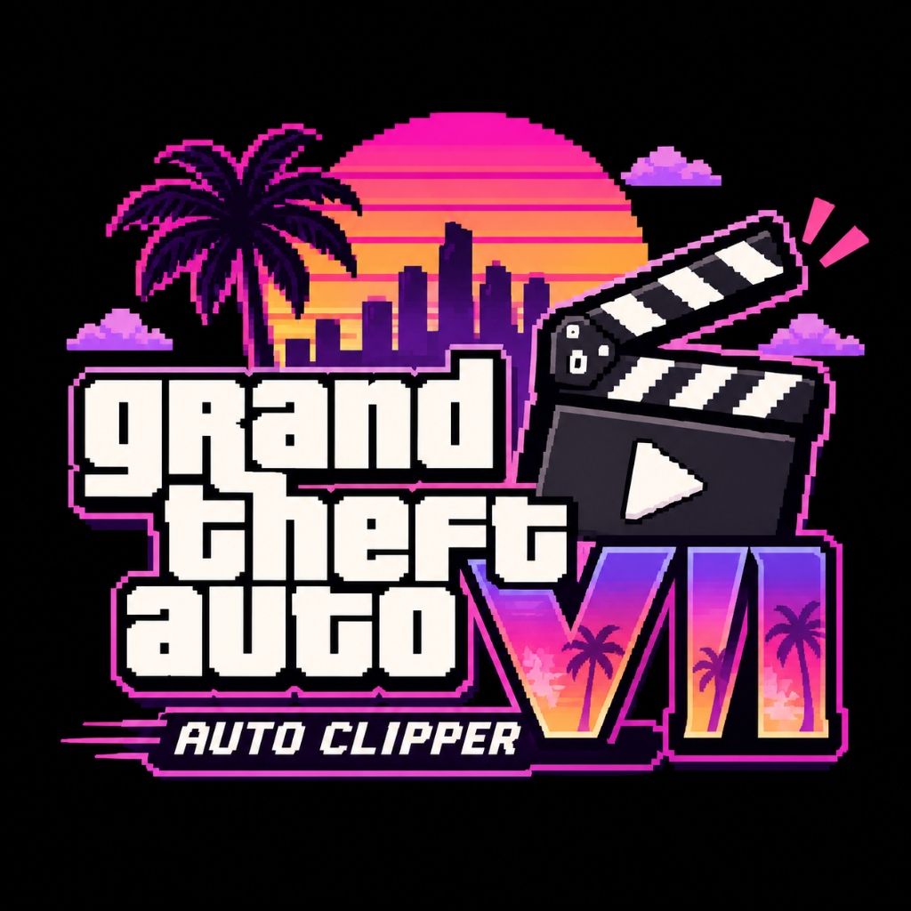

<div align="center">
  

  # 🎬 LocalClip GTA VI · Auto Clipper
  
  **Generator Video Pendek Vertikal Otomatis (YouTube Shorts, TikTok, Instagram Reels) Berbasis AI & Render Lokal macOS.**

  [](https://www.python.org/)
  [-black.svg)](https://apple.com)
  [](https://fastapi.tiangolo.com/)
  [](https://ffmpeg.org/)
  [](https://anthropic.com)

</div>

---

## 📌 Tentang Project

**LocalClip GTA VI (Auto Clipper)** adalah aplikasi web lokal untuk memotong dan mengonversi video panjang (seperti gameplay GTA, live streaming YouTube, podcast, atau rekaman MP4 lokal) menjadi klip vertikal pendek (9:16) yang siap diposting ke Shorts, TikTok, dan Reels.

Aplikasi ini menggunakan model AI (Claude / 9Router) untuk menganalisis transkrip dialog, menemukan momen-momen paling seru, mendeteksi wajah streamer, dan merender video vertikal menggunakan **FFmpeg** serta suara narator sintetis lokal macOS tanpa perlu upload video ke cloud eksternal.

---

## ✨ Fitur Utama

- 🎮 **Layout Streamer Split Screen**:
  - **Atas**: Wajah streamer hasil crop rapi (0–460 px).
  - **Tengah**: Banner pembatas gelap bergaris kuning (`#ffd24a`) yang menampilkan nama *CREATOR / JUDUL KLIP*.
  - **Bawah**: Video aksi gameplay dinamis (520–1280 px) dilengkapi subtitle teks tebal yang mudah dibaca.
- ✂️ **Interactive Visual Cropper**:
  - Pangkas wajah streamer langsung di browser dengan menggeser dan menarik kotak kuning di atas gambar frame video.
  - Tersedia tombol preset instan: **Kiri Bawah**, **Kiri Atas**, **Kanan Atas**, **Kanan Bawah**, dan **Reset AI**.
- 🌐 **Dukungan 9Router & Anthropic API**:
  - Mendukung koneksi langsung ke Anthropic API maupun melalui AI proxy/gateway lokal seperti **9Router** (`http://127.0.0.1:20128`).
  - Mendukung custom model (misal `gacorr`, `claude-3-5-sonnet`, dll).
- 🗣️ **Pilihan Bahasa Subtitle & Narasi**:
  - 🇮🇩 **Bahasa Indonesia**: Narasi suara jernih macOS `Damayanti` dengan subtitle bahasa Indonesia.
  - 🇺🇸 **English**: Narasi suara macOS `Samantha` dengan subtitle bahasa Inggris.
- ⏱️ **Auto-Clamping Durasi Cerdas**:
  - Klip otomatis dijaga dalam rentang aman 10–55 detik (maksimal 60 detik) sehingga tidak pernah melebihi batas durasi Shorts/Reels.
- 🔒 **100% Privat & Lokal**:
  - API key hanya disimpan di memori proses (tidak ditulis ke disk/database).
  - Video dan subtitle dirender langsung di komputer Anda.

---

## 📋 Prasyarat Sistem

Sebelum memulai, pastikan perangkat Anda memenuhi syarat berikut:
1. **Sistem Operasi**: macOS (Apple Silicon M1/M2/M3/M4 atau Intel).
2. **Python**: Versi `3.10` atau lebih tinggi.
3. **FFmpeg & ffprobe**: Untuk proses potong dan render video.
   ```bash
   brew install ffmpeg
   ```
4. **Koneksi Internet**: Untuk mengunduh video dari YouTube dan komunikasi ke API AI.

---

## 🚀 Tutorial Instalasi & Menjalankan

Ikuti langkah-langkah mudah di bawah ini untuk menjalankan aplikasi di Mac Anda:

### 1. Clone Repository
Buka terminal dan clone repositori ini:
```bash
git clone https://github.com/TSABIT1312/localclip-gtavi.git
cd localclip-gtavi
```

### 2. Buat Virtual Environment & Install Dependencies
Buat lingkungan virtual Python agar dependensi terisolasi rapi:
```bash
# Buat virtual environment
python3 -m venv .venv

# Aktifkan virtual environment
source .venv/bin/activate

# Install semua dependensi
pip install -r requirements.txt
```

### 3. Jalankan Aplikasi Web

Anda bisa memilih salah satu dari dua cara berikut:

#### Cara A: Sekali Klik (Launcher)
Klik dua kali file **`start.command`** di Finder. Terminal akan otomatis terbuka dan menyalakan server.

#### Cara B: Lewat Terminal
Jalankan perintah berikut di terminal:
```bash
.venv/bin/python -m uvicorn app:app --host 127.0.0.1 --port 8765
```

### 4. Buka di Browser
Setelah server berjalan, buka browser kesayangan Anda dan akses:
👉 **[http://127.0.0.1:8765](http://127.0.0.1:8765)**

---

## 📖 Panduan Penggunaan Web App

```
 [Input Video/YouTube] ──> [Analisis AI] ──> [Visual Crop & Edit] ──> [Render FFmpeg] ──> [Download MP4/ZIP]
```

### Langkah 1: Atur API Key & Provider AI
1. Di pojok kanan atas dashboard, klik tombol **"Pengaturan AI"**.
2. Masukkan konfigurasi Anda:
   - **Jika menggunakan 9Router**:
     - *Base URL*: `http://127.0.0.1:20128` (atau alamat port 9Router Anda)
     - *API Key*: Masukkan API key 9Router Anda
     - *Model*: Ketik nama model Anda (misalnya `gacorr` atau `anthropic/claude-3-5-sonnet`)
   - **Jika menggunakan Anthropic Resmi**:
     - *Base URL*: Kosongkan
     - *API Key*: Masukkan `sk-ant-...`
     - *Model*: Pilih atau isi `claude-3-5-sonnet-20241022`
3. Klik **Simpan Pengaturan**.

---

### Langkah 2: Buat Batch Klip Baru
1. Pada form **"Bikin batch baru"**:
   - **Link YouTube**: Masukkan link video YouTube (misalnya video stream Kai Cenat atau gameplay GTA VI).
   - *Atau upload file*: Anda juga bisa mengunggah file `.mp4` sendiri beserta file `.srt`.
2. **Jumlah Klip**: Pilih berapa klip yang ingin diekstrak (1 s/d 5 klip).
3. **Bahasa Subtitle & Narasi**: Pilih 🇮🇩 **Bahasa Indonesia** atau 🇺🇸 **English**.
4. **Nama Channel / Creator**: Nama yang akan ditampilkan pada banner kuning pemisah (misal: `Kai Cenat`).
5. Centang persetujuan pengiriman transkrip ke AI, lalu klik **Proses**.

---

### Langkah 3: Koreksi & Pangkas Wajah Streamer (Visual Cropper)
Setelah AI selesai menganalisis video dan menyiapkan kandidat:
1. Klik tombol **"Koreksi & crop"** pada kartu klip yang ingin disesuaikan.
2. Anda akan melihat gambar cuplikan video dengan **kotak pembatas kuning**:
   - **Geser kotak** ke posisi wajah streamer.
   - **Tarik sudut kotak** untuk memperbesar/memperkecil area pangkasan.
   - Atau gunakan tombol preset cepat: `📍 Kiri Bawah`, `📍 Kiri Atas`, `📍 Kanan Atas`, `📍 Kanan Bawah`.
3. Pilih **Gaya Layout Short**:
   - **Split Screen**: Wajah di atas, Banner pemisah kuning di tengah, Gameplay di bawah *(Rekomendasi)*.
   - **Contained 16:9**: Video full frame proporsional di tengah.
   - **No Facecam**: Fokus gameplay tanpa crop wajah.
4. Anda juga bisa mengedit judul klip, teks pembuka (hook), atau transkrip subtitle di panel ini.
5. Klik **Simpan & Render Ulang**.

---

### Langkah 4: Download Hasil Video
- Tonton preview video langsung di browser.
- Klik **Download MP4** untuk mengunduh video per klip.
- Atau klik tombol **Download ZIP** di bagian atas batch untuk mengunduh seluruh klip sekaligus dalam satu arsip zip.

---

## 🛠️ Perintah Berguna & Pengujian

Untuk menjalankan unit test otomatis guna memastikan seluruh fungsi validasi dan parsing berjalan normal:
```bash
.venv/bin/python -m unittest -v test_app.py
```

Untuk menjalankan smoke test pipeline rendering:
```bash
.venv/bin/python smoke_test.py
```

---

## 📁 Struktur Direktori

```text
localclip-gtavi/
├── assets/
│   └── banner.jpg          # Logo & banner header project
├── app.py                  # Server FastAPI, API endpoint, & background worker
├── render.py               # Engine render video FFmpeg, layout, & TTS macOS
├── index.html              # Frontend UI interaktif & visual image cropper
├── start.command           # Launcher one-click untuk macOS
├── requirements.txt        # Dependensi Python (FastAPI, Uvicorn, Pillow, yt-dlp, dll)
├── test_app.py             # Unit tests
├── smoke_test.py           # Smoke test script
├── .gitignore              # Proteksi data video, venv, cache, dan secret
└── README.md               # Dokumentasi panduan lengkap
```

---

## 📄 Lisensi & Disclaimer

- Project ini dibuat untuk penggunaan lokal dan personal.
- Pastikan Anda memiliki hak cipta atau izin untuk memproses dan mempublikasikan ulang video yang diunduh dari YouTube.
- AI menghasilkan rekomendasi berdasarkan transkrip; selalu tinjau ulang hasil klip sebelum mempublikasikannya ke media sosial.

---

<div align="center">
  Dibuat dengan ❤️ untuk para kreator konten dan clipper GTA VI / Gaming.
</div>
